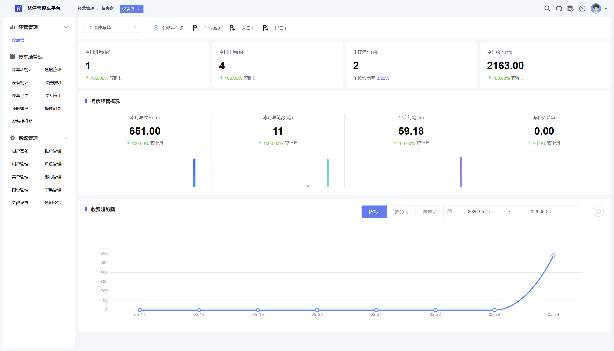

当前版本：2.8.1

[🔥 慧猫开源停车平台 · 后端微服务端](https://github.com/Roinli2561/HUIMAO-ParkOS-cloud)

[🔥 慧猫开源停车平台 · 前端源码](https://github.com/Roinli2561/HUIMAO-ParkOS-admin)

[🔥 慧猫开源停车平台 · 小程序源码](https://github.com/Roinli2561/HUIMAO-ParkOS-miniapp)（当前）

[🔥 个人博客](https://wenhui.huizhidata.com)

<div align="center">

# HUIMAO Parking · 车主小程序

慧猫开源停车平台 · 车主端（uni-app，可发布微信小程序 / H5）

</div>
<div align="center">
    
    
</div>
<p align="center">
  <a href="https://github.com/Roinli2561/HUIMAO-ParkOS-cloud">☁️ Cloud 云端服务</a> ·
  <a href="https://github.com/Roinli2561/HUIMAO-ParkOS-admin">🖥️ Admin 运营管理后台</a> ·
  <b>📱 MiniApp 车主小程序</b>
</p>
<p align="center">
  如果对您有帮助，您可以点右上角 "Star" ❤ 支持一下谢谢！
</p>

---

## 📖 项目介绍

HUIMAO Parking（慧猫开源停车平台）是一款基于 MIT 协议发布的开源停车场数字化解决方案，代码全开源无加密，可免费商用，适合各类物业、停车场运营方及开发者快速构建多租户一体化停车管理平台。





### 系统演示

车主端小程序：扫码体验


整套系统分为三个端，数据统一、业务同步：

| 端 | 仓库 | 说明 |
| --- | --- | --- |
| ☁️ 云端服务 | [HUIMAO-ParkOS-cloud](https://github.com/Roinli2561/HUIMAO-ParkOS-cloud) | 后端微服务（Spring Cloud Alibaba） |
| 🖥️ 运营管理后台 | [HUIMAO-ParkOS-admin](https://github.com/Roinli2561/HUIMAO-ParkOS-admin) | Web PC 管理端 |
| 📱 车主小程序 | **HUIMAO-ParkOS-miniapp（本仓库）** | 车主端（uni-app） |

本仓库为**车主小程序**，为车主提供"扫码即达、查询即用、支付即走"的停车缴费闭环体验，与云端服务、运营管理后台配合使用。

### 核心功能
- 扫码缴费：扫描停车场二维码，查询当前待支付订单并发起支付
- 车牌缴费：输入车牌号查询待支付订单
- 我的车辆：绑定 / 解绑常用车辆
- 停车记录：查询历史停车订单与缴费记录
- 支付结果：支付完成状态反馈

## 💻 技术架构

```
uni-app（Vue 2 语法）+ uView UI 2.0
z-paging（列表分页加载）
decimal.js / moment / js-md5
```

- 请求层统一封装：token 鉴权 + 时间戳与 MD5 签名（见 `config/request.js`）
- 可编译目标：微信小程序 / H5 / App（平台配置见 `manifest.json`）
- 业务接口：云端服务开放接口 `/parking/open/h5/*`，服务地址在 `env.js` 中配置

## 🚀 快速开始

环境要求：HBuilderX（或 uni-app CLI 环境）+ 微信开发者工具

```bash
# 安装依赖（uview-ui、z-paging 等）
npm install
```

1. 使用 HBuilderX 打开本项目
2. 在 `manifest.json` 中配置微信小程序 `appid`
3. 接口地址默认指向 `http://182.40.195.136:48081`（见 `env.js` 的 `BASE_URL`），接入自有云端服务时修改即可
4. 运行到微信开发者工具（或 H5）进行体验

## 📁 目录结构

```
pages/                页面
├── index/            首页、我的、登录
└── sub-packages/     分包：扫码缴费、车牌缴费、绑定车辆、车辆列表、停车记录、支付、支付结果
components/           自定义导航栏、tabbar、车牌输入等组件
config/               接口封装（api.js / request.js / md5Utils.js）
env.js                接口地址等环境配置
static/               静态图片资源
manifest.json         uni-app 应用配置（各端 appid、SDK 等）
pages.json            页面路由与 tabBar 配置
```

## 📚 相关资料

- ☁️ 云端服务：https://github.com/Roinli2561/HUIMAO-ParkOS-cloud
- 🖥️ 运营管理后台：https://github.com/Roinli2561/HUIMAO-ParkOS-admin

---

© 2026 HUIMAO Parking 版权所有
开源协议：MIT